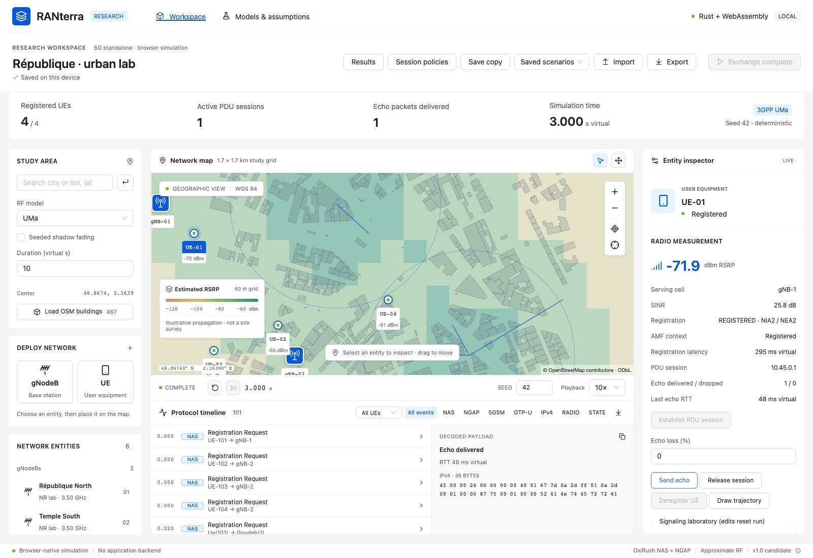

# RANterra

Browser-native 5G research application: React/MapLibre/deck.gl with a browser-independent Rust engine running as WebAssembly in a Worker. Network emulation needs no backend. Geographic assets are optional external services.



The workspace follows [Ant Design's visual language](https://ant.design/design.md), with a map, live network metrics, protocol inspection, entity controls, results dialogs and responsive inspectors. [Interface design and validation](docs/ui-design.md).

**Current build: 1.0.0-rc.1. The requested production v1.0 release gates are not all satisfied.** See [release evidence and blockers](docs/V1_RELEASE_REPORT.md). This is a synthetic laboratory implementation of a documented subset, not a carrier core, certification of 3GPP compliance, or standardized 6G implementation.

## Run

Use Node.js 24.18.0, npm, rustup with Rust 1.97.1 (pinned in `rust-toolchain.toml`), and wasm-pack 0.15.0. Put rustup's `~/.cargo/bin` on PATH. The repository `.npmrc` requires normal peer resolution; do not regenerate the lockfile with legacy peer handling. Desktop Chromium and Firefox are covered by automated tests; WebGL2, WASM, Workers and IndexedDB are required.

```sh
export PATH="$HOME/.cargo/bin:$PATH"
rustup target add wasm32-unknown-unknown
cargo install wasm-pack --version 0.15.0 --locked
npm ci
npm run build:wasm
npm run dev
```

Open http://127.0.0.1:5173. For static production output:

```sh
npm run build
node scripts/serve-dist.mjs
```

Open http://127.0.0.1:4173. This verification server serves **only static `dist/` assets** and applies the included hosting headers. Nothing is published externally. `npm run preview` also serves the build but does not apply hosting `_headers`.

## Run an experiment

1. Import `examples/minimal.json`, or use the Paris demo. The current demo selects UMa; old version-1 files without a radio configuration preserve the legacy model.
2. Run at 10× playback, then select a UE. REGISTERED appears only after authenticated, integrity-protected Registration Complete reaches the AMF.
3. Establish PDU session, send echo, then release session. The default service is IPv4, DNN `lab`, SST 1 and QFI 1; **Session policies** configures DNN/SST/optional SD and capacity, with per-UE requests in the inspector. Packets target virtual `10.45.255.1`, never the internet.
4. Inspect NAS, NGAP, 5GSM, GTP-U and IPv4 events. Protected NAS rows show verified decoded content alongside original ciphertext. The gNodeB only relays NAS ciphertext.
5. Use **Deregister UE** for protected NAS deregistration and logical N2 context release. Reset before registering again.
6. Draw a trajectory by clicking map waypoints, choose speed in m/s, and finish the trajectory. Movement runs in 100 ms virtual ticks for the configured duration. A3-style changes are **reassociation, not protocol handover**. Reassociation invalidates the old registration/session; reset is needed to reconnect.
7. Select a laboratory fault to reproduce authentication failures, or configure signaling delay/loss and N2 rejection. `examples/signaling-recovery.json` combines a lost Security Mode Complete with a second UE configured for N2 rejection. Each UE has independent contexts. No real subscriber credential import is supported.
8. Export scenario, event log, or results. In Results, **Export experiment / Save run** capture the timestamped Rust command journal and current virtual-time checkpoint. Import or **Restore saved run** reconstructs active sessions and in-flight packets without exporting keys. **Compare experiment** replays another run for comparison. Save copy still stores initial configuration.

Start/pause/resume/step/reset, seeds, playback speed, duration, coverage layers, cell/UE configuration, and geographic navigation remain in the existing workspace. Scenario edits reset execution transactionally. The latest 500 filtered timeline rows are rendered; exports retain the bounded full history (16,384 rows), with an explicit limit indicator.

## Implemented scope

- Synthetic null-scheme SUCI and subscriber provisioning; MILENAGE AUTN/SQN verification, RES*/XRES* and HRES*/HXRES*, KAUSF/KSEAF/KAMF/NAS keys.
- NIA2/NEA2 NAS security, independent directional COUNTs, Security Mode capability replay and initial NAS container verification, Registration Accept/Complete, failure isolation, T3560/T3550 retransmissions, normal initial-registration T3510/T3511/T3502 recovery and deregistration.
- Real OxiRush NAS/NGAP codecs; InitialUEMessage, UL/DLNASTransport, PDU resource setup/release and UE context release.
- Configurable DNN/S-NSSAI (SST + optional SD), per-policy capacity and protected rejects/backoff; one IPv4 PDU session per UE, protected N1 SM transport, local SMF/UPF control, distinct directional TEIDs, IPv4/ICMP echo, GTP-U validation and per-session traffic statistics.
- UMi/UMa LOS/NLOS path loss from TR 38.901 v18.0.0 within explicitly enforced ranges, optional sector pattern and seeded shadowing, thermal noise and full-load co-channel SINR.
- Deterministic waypoint mobility, coverage loss and configurable A3 hysteresis/TTT in scenario radio configuration.
- Native execution, WASM execution, production worker tests, Chromium/Firefox automation, input bounds, provider configuration, static hosting headers, CI and dependency/license checks.

Important reductions: no RRC/AS security/PHY, NG setup or real SCTP/UDP; no PFCP (SMF/UPF control is collocated); one IPv4 session per UE with fixed QFI/5QI; no emergency/NB-N1 timer variants or mobility registration update; no protocol handover, automatic reconnection, terrain or height-aware building RF. Session control and echo use scheduled virtual delays; deregistration remains atomic at the current virtual time after explicit session release. These are material limits, not transparent substitutes for omitted protocol functionality.

## Verification

```sh
npm run build
npm test
npm run lint
cargo fmt --all --check
cargo clippy --workspace --all-targets --locked -- -D warnings
npx playwright install chromium firefox
npm run test:browser
npm run test:replay
npm run test:inputs
# Independent codec validator additionally requires Go 1.27.2 (validation toolchain only):
npm run test:protocols
npm audit --audit-level=moderate
cargo install cargo-audit --version 0.22.2 --locked
cargo audit
node scripts/check-licenses.mjs
npm run benchmark
npm run benchmark:wasm
node scripts/verify-build.mjs
```

`npm test` runs native Rust, actual WASM, and the built worker. Build first. Browser tests run production assets under CSP and block external geographic traffic; they do not mock the protocol engine. The GitHub workflow additionally compares build manifests, verifies KDF fixtures and runs the standalone free5GC codec validator. No Go code is linked into the browser application. Replay is verified in both directions between native Rust and WASM.

Native example:

```sh
cargo run --locked -p ranterra-engine --example replay -- examples/minimal.json
```

## Documentation

- [Release report and acceptance gates](docs/V1_RELEASE_REPORT.md)
- [Architecture](docs/architecture.md)
- [Protocol support and exact references](docs/protocol-support.md)
- [RF assumptions and validation](docs/radio-validation.md)
- [Research reproducibility](docs/reproducibility.md)
- [Security and privacy](docs/security.md)
- [Static deployment](docs/deployment.md) and [free hosting options](docs/hosting-options.md)
- [Verification record](docs/verification.md)
- [OSM attribution](docs/data-attribution.md)
- [Dependency inventory](docs/DEPENDENCIES.json)

Geographic providers are configured in `public/config.json` (deployed as `/config.json`, no rebuild needed). Place search is disabled by default; coordinate navigation remains available. Configure a permitted provider before enabling geocoding. OSM Standard tiles are for light interactive use, with attribution and browser caching, not bulk download or production traffic at arbitrary scale. See the [current tile policy](https://operations.osmfoundation.org/policies/tiles/) and [Nominatim policy](https://operations.osmfoundation.org/policies/nominatim/).

Code is [MIT](LICENSE). OSM-derived datasets remain ODbL. Introduced direct Rust dependencies use MIT/Apache-2.0; no AGPL code was integrated. Fonts retain OFL and relevant data retain attribution terms. This software must never be supplied with production subscriber keys.

Independent endpoint and bounded reliability checks: `npm run test:protocols` (Go 1.27.2 validation toolchain) and `npm run test:soak` after building. The latter defaults to 128 real WASM lifecycle/replay/free cycles; `RANTERRA_SOAK_CYCLES=16384 npm run test:soak` reproduces the extended campaign. See [interoperability evidence and limits](docs/interop-validation.md). Stable v1 release gates remain open.

The SMF/AUTS follow-up adds independently driven shared session allocation/policy/release and T3592 boundary validation. Import `examples/auts-resynchronization.json` (or choose `SqnOutOfSync`) to inspect real cause-21/AUTS recovery followed by secured registration and virtual traffic. The per-UE signaling controls now expose deterministic session delay, bounded message loss and an encoded N2 resource failure. New recordings use profile 3; existing profile-2 recordings retain legacy atomic execution. Registration retransmissions and session cleanup are covered by native, independent-peer and browser tests. See [current release gates](docs/V1_RELEASE_REPORT.md) and [exact validation boundary](docs/interop-validation.md).
